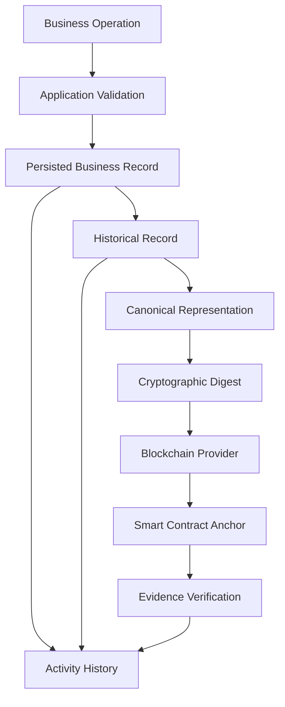
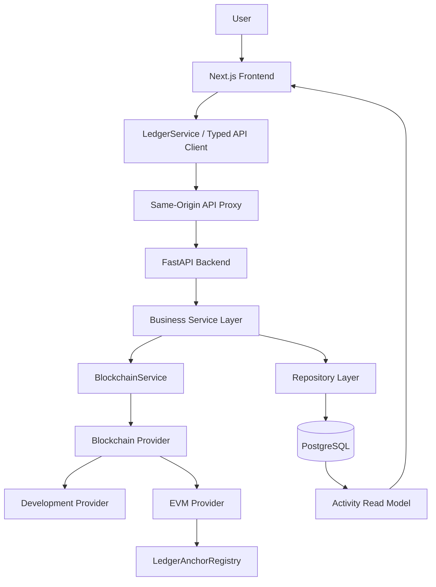

# LedgerChain
### Blockchain-Powered Business Trust & Traceability Platform

LedgerChain is a full-stack business trust and traceability platform designed to connect financial transactions, inventory, supply-chain operations, digital asset ownership, provenance, and cryptographic verification through a unified system.

Businesses generate records every day, but maintaining trustworthy histories across financial operations, inventory movements, shipments, and asset ownership can be challenging. LedgerChain addresses this problem by combining structured business workflows with auditable records and blockchain-based evidence.

Rather than storing an entire business application on a blockchain, LedgerChain uses blockchain as an evidence and verification layer. Business records remain in the application database, while cryptographic digests can be anchored on-chain to support independent verification of recorded evidence.

**Core principle:**

> Record the event. Preserve its history. Generate verifiable evidence. Verify its integrity.

---

## Table of Contents

- [Overview](#overview)
- [Key Features](#key-features)
- [How It Works](#how-it-works)
- [Architecture](#architecture)
- [Technology Stack](#technology-stack)
- [Security and Data Integrity](#security-and-data-integrity)
- [Getting Started](#getting-started)
- [Environment Configuration](#environment-configuration)
- [Blockchain and Verification](#blockchain-and-verification)
- [Resource-Conscious Design](#resource-conscious-design)
- [Limitations](#limitations)
- [Future Scope](#future-scope)
- [License](#license)

## Overview

LedgerChain brings multiple business domains together under a common trust model.

| Domain | Purpose |
|---|---|
| Finance | Manage internal transactions, account balances, and financial records. |
| Ledger | Maintain balanced, auditable debit and credit entries for completed payments. |
| Inventory | Track products, stock quantities, locations, and inventory movements. |
| Supply Chain | Connect inventory and shipment workflows with traceable operational histories. |
| Digital Assets | Track asset ownership, custody, lifecycle changes, and provenance. |
| Verification | Examine recorded histories and verify cryptographic evidence. |
| Blockchain | Anchor supported records through a provider-based smart-contract architecture. |
| Activity | Present meaningful business events in a chronological operational history. |

The platform is designed around organization-scoped business records, controlled access, traceable state changes, and a consistent application-to-blockchain architecture.

## Key Features

### 1. Finance and Internal Payments

LedgerChain provides a foundation for internal financial transactions between participating accounts.

Key capabilities include:

- Account-based internal INR transfers.
- Payment validation and balance checks.
- Exact-decimal monetary calculations.
- Idempotency protection against duplicate submissions.
- Transactional consistency between payment records, balance updates, and ledger posting.
- Participant-scoped transaction access.
- Chronological transaction history.

Demo funding may be used to demonstrate the payment workflow. It is explicitly a test mechanism and does not represent a connection to a real bank or the movement of real money.

### 2. Double-Entry Ledger

Completed payments can produce corresponding ledger transactions containing debit and credit entries.

For a transfer of amount \(X\):

```text
Sender Account       DEBIT     X
Recipient Account    CREDIT    X
                             -----
                    Debits = Credits
```

The ledger is designed to preserve accounting consistency, provide an auditable transaction history, and prevent unauthorized changes to posted records.

### 3. Products and Inventory

Inventory management extends beyond maintaining a product catalogue.

The inventory domain supports operational stock tracking, including:

- Products and SKUs.
- Stock quantities and locations.
- Stock-in and stock-out operations.
- Inventory movements between locations.
- Reasoned stock adjustments.
- Low-stock thresholds.
- Movement history.
- Idempotent inventory operations.

Inventory movements preserve information about quantity changes, locations, reasons, and the associated operation. This makes it possible to investigate how inventory reached its current state.

### 4. Supply-Chain Traceability

LedgerChain is designed to connect inventory and shipment operations into a traceable business workflow.

```text
Product
   |
   v
Batch / Inventory
   |
   v
Shipment
   |
   v
Dispatch --> Transfer --> Receipt
                           |
                           v
                       Provenance
                           |
                           v
                       Verification
                           |
                           v
                   Blockchain Evidence
```

The purpose is to make business transitions easier to track and audit, rather than simply storing the current location or quantity of an item.

The scope focuses on practical business traceability rather than a full enterprise resource planning or fleet-management system.

### 5. Digital Asset Ownership and Custody

LedgerChain maintains individual asset records and their associated histories.

Depending on the supported workflow, asset records can include:

- Current ownership.
- Current custodian.
- Lifecycle status.
- Ownership transfers.
- Custody changes.
- Provenance events.
- Historical state information.
- Integrity verification.
- Blockchain evidence for supported events.

**Ownership and custody are separate concepts.** An organization may own an asset while another organization holds or manages it.

Transitions preserve historical information instead of relying exclusively on the current state. Account-number-based transfers can resolve eligible recipient accounts while applying authorization and idempotency checks.

### 6. Provenance and Verification

Provenance explains how a record or asset reached its current state.

LedgerChain combines historical business events with verification mechanisms to help distinguish between a consistent application history and independently anchored blockchain evidence.

The system is designed to distinguish statuses such as:

- Not anchored.
- Confirmation pending.
- Simulated or development anchor.
- Blockchain evidence verified.
- Evidence mismatch.

The exact statuses available depend on the record type and configured provider.

### 7. Blockchain Evidence

LedgerChain uses a provider-based blockchain architecture and a Solidity smart-contract registry, `LedgerAnchorRegistry`, for supported evidence-anchoring workflows.

The application can generate a canonical representation of a supported record and calculate a cryptographic digest. The digest can then be submitted through the configured blockchain provider.

This approach avoids putting the entire application database or sensitive business records on-chain.

Development simulation is distinguished from a real blockchain transaction. A simulated result must never be interpreted as proof of a public-chain transaction.

### 8. Unified Activity History

The Activity system provides a chronological view of meaningful events across supported business domains.

Depending on the configured functionality, these can include payment activity, inventory movements, shipment transitions, asset events, and blockchain evidence operations.

The Activity feed is a read model over persisted application records. It is not intended to replace the underlying business records or introduce a separate event-sourcing infrastructure.

---

## How It Works

LedgerChain follows a shared record-and-evidence workflow.



Not every operation automatically creates a blockchain anchor. Anchoring is available only for supported record types and depends on the configured provider.

The system separates operational correctness from blockchain evidence: a business transaction must first satisfy application-level validation and authorization. Blockchain anchoring supplements the record; it does not replace the application's database or business rules.

## Architecture

LedgerChain follows a layered full-stack architecture.



### Frontend

The frontend provides the user interface, protected application routes, forms, activity views, and domain-specific workflows. A service/API boundary separates UI components from backend implementation details.

### Backend

FastAPI exposes versioned API endpoints. Business services handle validation, authorization, transaction workflows, and domain rules. Repository components manage database interactions.

### Database

PostgreSQL stores persistent business records, accounts, transactions, ledger entries, inventory data, asset histories, and blockchain-related metadata. SQLAlchemy provides database access, while Alembic manages schema migrations.

### Blockchain Layer

Blockchain interactions pass through a service and provider abstraction. This keeps business logic independent of a particular blockchain implementation and permits a development provider or a configured EVM-compatible provider.

## Technology Stack

The project architecture uses the following technologies. Exact versions and optional components should be taken from the repository's dependency manifests.

| Layer | Technology |
|---|---|
| Frontend | Next.js, React, TypeScript |
| UI styling | Tailwind CSS |
| Backend API | Python, FastAPI |
| Database | PostgreSQL |
| ORM | SQLAlchemy |
| Database migrations | Alembic |
| Smart contracts | Solidity |
| Blockchain integration | EVM-compatible provider architecture |
| API communication | Typed client and service boundary |
| Testing | Python test suite, frontend type checking and production build |

## Security and Data Integrity

Security and integrity are central to the design.

The application incorporates or is designed around the following controls where implemented in the active codebase:

- Password hashing using Argon2id.
- Session-based authentication.
- CSRF protection and origin validation.
- Rate limiting.
- Organization-scoped access control.
- Server-side authorization checks.
- Cross-organization data isolation.
- Idempotency for supported write operations.
- Transactional database updates.
- Append-only histories for supported record types.
- Cryptographic digests for supported blockchain evidence.
- Explicit separation between simulated and real blockchain results.

A cryptographic digest can help establish whether recorded evidence matches an anchored digest. It does not independently prove that a physical-world event occurred exactly as described. Reliable verification also depends on the integrity of the original data, the process that recorded it, and the identity and authorization of the participants.

## Getting Started

The following instructions describe the intended development setup. Verify the repository's current manifests, environment examples, and backend documentation before running commands, as required dependencies and scripts can differ between repository versions.

### Prerequisites

- Git
- Node.js and a compatible package manager
- Python and a virtual environment
- PostgreSQL
- Any additional tools required by the configured blockchain or smart-contract workflow

### 1. Clone the repository

```bash
git clone <YOUR_PUBLIC_REPOSITORY_URL>
cd <YOUR_REPOSITORY_DIRECTORY>
```

Replace the placeholders with the actual public repository URL and directory name.

### 2. Configure the backend

Navigate to the backend directory and create a virtual environment:

```bash
cd backend
python -m venv .venv
```

Activate it on Windows:

```powershell
.venv\Scripts\Activate.ps1
```

Or on Linux/macOS:

```bash
source .venv/bin/activate
```

Install the dependencies using the package or requirements file provided in the repository. For example, if the project contains `requirements.txt`:

```bash
pip install -r requirements.txt
```

Configure the backend environment variables using the documented environment example. Set up PostgreSQL and apply the database migrations before starting the API.

If Alembic is configured in this directory, the migration command is:

```bash
alembic upgrade head
```

Start the API using the application's actual FastAPI entry point. For an entry point at `app.main:app`, the command is:

```bash
uvicorn app.main:app --reload
```

### 3. Configure the frontend

From the repository root, install dependencies using the package manager indicated by the lockfile. If the project uses pnpm:

```bash
pnpm install
```

Configure the frontend environment variables according to the repository's environment example, then start the development server using the available package script:

```bash
pnpm dev
```

### 4. Run checks

Use the scripts and test configuration available in the repository. Typical checks for this architecture include:

```bash
pnpm exec tsc --noEmit
pnpm run build
```

For a Python backend using pytest:

```bash
python -m pytest
```

The application also requires a correctly configured database and any necessary external services for integration workflows. Passing type checks or building the frontend does not, by itself, establish that the complete application has been deployed or verified against a live database or public blockchain.

> **Setup note:** The commands above are a starting point for the described architecture. Confirm the actual entry points, package scripts, dependency files, environment variables, and migration configuration in this repository before treating them as a verified, one-command installation procedure.

## Environment Configuration

Keep secrets outside source control. Use environment variables or a secure deployment configuration for database credentials, application secrets, allowed origins, API URLs, email configuration, and blockchain-provider settings.

Never commit:

- Database passwords.
- Session or application secrets.
- Private keys or signing credentials.
- Production environment files.
- Real user data.

Document only the environment-variable names that are actually supported by the current implementation.

## Blockchain and Verification

LedgerChain treats blockchain as a complementary evidence layer rather than a replacement for its application database.

The intended process is:

1. Record and validate a business event.
2. Preserve the relevant application history.
3. Construct a deterministic canonical representation for a supported record.
4. Calculate a cryptographic digest.
5. Submit the evidence through the configured provider.
6. Verify the resulting evidence against the recorded digest.

The development provider and an actual public EVM deployment are different operating modes. A real blockchain transaction requires a correctly configured network, deployed contract, provider access, and authorized signing infrastructure.

**A simulated anchor is not a public blockchain transaction.** LedgerChain should display the actual status returned by the configured implementation and must not fabricate transaction hashes, block numbers, or confirmations.

## Resource-Conscious Design

LedgerChain is designed to keep its architecture practical for modest deployment environments.

The approach emphasizes:

- A single modular backend rather than unnecessary microservices.
- Bounded and paginated history queries.
- Database indexes and constraints where appropriate.
- Avoiding unnecessary duplication of business records.
- Keeping sensitive business data off-chain.
- Avoiding the need to run a dedicated blockchain node for ordinary application operation.
- Separating core business workflows from optional blockchain operations.

The objective is to maintain useful functionality and sound architecture without introducing distributed infrastructure that the project's scale does not require.

## Limitations

LedgerChain should be evaluated according to its configured environment and implemented functionality.

- Internal payments are not equivalent to real-world bank settlement.
- Demo funding is a testing mechanism, not a banking integration.
- Blockchain evidence verifies a recorded digest, not the physical truth of an event.
- Simulated blockchain mode does not produce a real public-chain transaction.
- Real EVM anchoring depends on network, contract, and signer configuration.
- Email delivery and other external integrations require their respective services to be configured.
- Features and workflows must be verified against the particular repository revision and deployment being evaluated.

These boundaries are intentional: the system distinguishes actual application behavior from integrations that require external infrastructure.

## Future Scope

Potential future improvements, subject to project requirements, include:

- Expanded end-to-end shipment traceability across participating organizations.
- Additional verification workflows for supported business events.
- Deployment of the anchor contract to a suitable EVM test network.
- Independent verification tooling for recorded blockchain evidence.
- Improved operational monitoring and deployment automation.

These items represent potential extensions and should not be interpreted as completed functionality unless implemented in the current codebase.

## License

Check the repository for a `LICENSE` file and follow its terms. If no license is present, the project's reuse and distribution permissions should not be assumed.

---

**LedgerChain — Connecting business operations with traceable records and verifiable evidence.**
